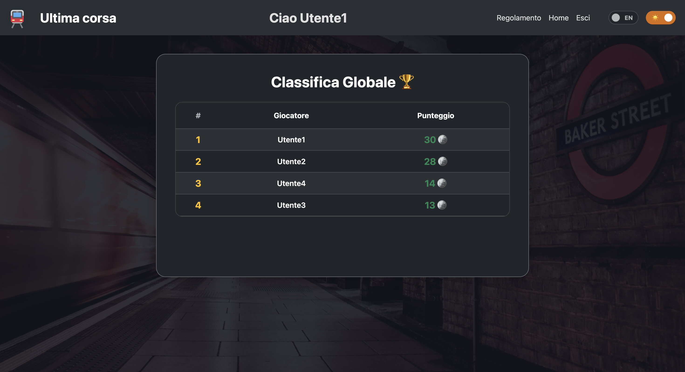
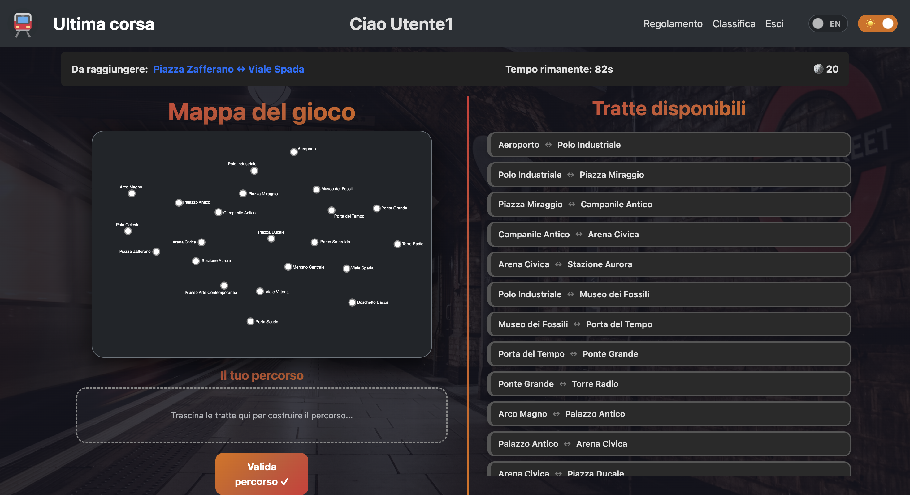

# Exam #1: "Ultima Corsa"
## Student: s360836 Viviano Giacomo

## React Client Application Routes

- Route `/`: se l'utente è autenticato mostra il gioco (`GamePage`); altrimenti mostra il regolamento (`RulesPage`).
- Route `/login`: form di accesso. Disponibile solo per visitatori anonimi; dopo il login reindirizza a `/`.
- Route `/leaderboard`: classifica generale con il miglior punteggio per ogni utente registrato. Disponibile solo per utenti autenticati.
- Route `/rules`: pagina del regolamento di gioco. Disponibile solo per utenti autenticati (i visitatori anonimi la vedono già su `/`).
- Route `/*`: pagina 404 (`NotFoundLayout`) per qualsiasi URL non riconosciuto.

## API Server

- POST `/api/sessions`
  - Request parameters: nessuno.
  - Request body: `{ "username": "string", "password": "string" }`.
  - Response body: oggetto utente autenticato, ad esempio `{ "id": number, "username": "string" }`.
  - Response status: `201 Created` in caso di successo; `401 Unauthorized` se le credenziali sono errate; `422 Unprocessable Entity` se il corpo della richiesta è mancante, vuoto o non valido; `500 Internal Server Error` in caso di errori di autenticazione o di sessione.

- GET `/api/sessions/current`
  - Request parameters: nessuno.
  - Request body: nessuno.
  - Response body: utente autenticato, ad ad esempio `{ "id": number, "username": "string" }`.
  - Response status: `200 OK` se l'utente è autenticato; `401 Unauthorized` se non c'è una sessione attiva.

- DELETE `/api/sessions/current`
  - Request parameters: nessuno.
  - Request body: nessuno.
  - Response body: corpo vuoto.
  - Response status: `200 OK` in caso di successo; `500 Internal Server Error` se il logout fallisce.

- GET `/api/stazioni`
  - Request parameters: nessuno.
  - Request body: nessuno.
  - Response body: lista delle stazioni, ad esempio `[ { "sid": 1, "nomeStazione": "Centrale", "xCoordCircle": 100, "yCoordCircle": 100, "xCoordName": 110, "yCoordName": 110, "Interscambio": 1 }, ... ]`.
  - Response status: `200 OK` in caso di successo; `401 Unauthorized` se non autenticato; `500 Internal Server Error` in caso di errori del server o del database.

- GET `/api/tratte`
  - Request parameters: nessuno.
  - Request body: nessuno.
  - Response body: lista delle tratte, ad esempio `[ { "tid": 1, "sidStart": 1, "sidEnd": 2, "lid": 1 }, ... ]`.
  - Response status: `200 OK` in caso di successo; `401 Unauthorized` se non autenticato; `500 Internal Server Error` in caso di errori del server o del database.

- GET `/api/linee`
  - Request parameters: nessuno.
  - Request body: nessuno.
  - Response body: lista delle linee, ad esempio `[ { "lid": 1, "nomeLinea": "Rossa" }, ... ]`.
  - Response status: `200 OK` in caso di successo; `401 Unauthorized` se non autenticato; `500 Internal Server Error` in caso di errori del server o del database.

- GET `/api/leaderboard`
  - Request parameters: nessuno.
  - Request body: nessuno.
  - Response body: lista degli utenti con il loro miglior punteggio, ad esempio `[ { "uid": 1, "username": "Utente1", "max_score": 15 }, ... ]`.
  - Response status: `200 OK` in caso di successo; `401 Unauthorized` se non autenticato; `500 Internal Server Error` in caso di errori del server o del database.

- GET `/api/partita/start`
  - Request parameters: nessuno.
  - Request body: nessuno.
  - Response body: stazioni di partenza e arrivo generate casualmente, ad esempio `{ "startStation": 5, "endStation": 12 }`.
  - Response status: `200 OK` in caso di successo; `401 Unauthorized` se non autenticato; `500 Internal Server Error` in caso di errori del server o del database.

- POST `/api/partita`
  - Request parameters: nessuno.
  - Request body: `{ "path": [1, 2, 3], "startStation": 1, "endStation": 4 }`.
  - Response body: valutazione della partita, ad esempio `{ "valid": true, "events": [{ "eid": 1, "nomeEvento": "Ritardo", "scoreEvento": -2 }], "score": 10, "pid": 42 }`.
  - Response status: `200 OK` in caso di successo; `401 Unauthorized` se non autenticato; `422 Unprocessable Entity` se il corpo della richiesta è mancante, vuoto o non valido; `500 Internal Server Error` in caso di errori del server o del database.

## Database Tables

- Table `Utenti` - contiene `uid` (PK), `username`, `password` (hash scrypt), `salt`. Memorizza le credenziali degli utenti registrati.
- Table `Partite` - contiene `pid` (PK), `uid` (FK → Utenti), `score`. Storico di tutte le partite giocate con il relativo punteggio finale.
- Table `Stazioni` - contiene `sid` (PK), `nomeStazione`, `xCoordCircle`, `yCoordCircle`, `xCoordName`, `yCoordName`, `Interscambio`. Stazioni della rete metropolitana con coordinate SVG per la visualizzazione della mappa e flag di interscambio.
- Table `Tratte` - contiene `tid` (PK), `sidStart` (FK → Stazioni), `sidEnd` (FK → Stazioni), `lid` (FK → Linee). Connessioni dirette tra coppie di stazioni, appartenenti a una linea specifica.
- Table `Linee` - contiene `lid` (PK), `nomeLinea`. Le 5 linee della rete metropolitana (Verde, Blu, Gialla, Rossa, Viola).
- Table `Eventi` - contiene `eid` (PK), `nomeEvento`, `descrizione`, `scoreEvento`. I 18 eventi casuali con effetto in monete (da -4 a +4) che possono verificarsi durante ogni tratta.

## Main React Components

- `App` (in `App.jsx`): componente radice. Gestisce autenticazione, recupero dati dal server (stazioni, tratte, linee, eventi, classifica), stato globale del gioco (`isGameStarted`) e i context di lingua e tema.
- `MainPage` (in `MainPage.jsx`): layout principale con Header fisso in cima e `<Outlet />` per il contenuto delle route figlie.
- `Header` (in `Header.jsx`): barra di navigazione sticky con logo, saluto utente autenticato e `NavMenu`.
- `NavMenu` (in `NavMenu.jsx`): menu contestuale (link home/regolamento/classifica/login/logout), toggle lingua IT↔EN e toggle tema chiaro/scuro.
- `CustomMenuToggle` (in `CustomMenuToggle.jsx`): bottone personalizzato animato per l'apertura/chiusura del menu a tendina.
- `LanguageContext` (in `LanguageContext.jsx`): context React per fornire e gestire lo stato della lingua (IT/EN).
- `ThemeContext` (in `ThemeContext.jsx`): context React per fornire e gestire lo stato del tema (chiaro/scuro).
- `GamePage` (in `GamePage.jsx`): componente principale del gioco. Orchestra le 4 fasi (Setup, Pianificazione, Esecuzione, Risultato) usando il hook `useGameState`.
- `Map` (in `Map.jsx`): mappa SVG interattiva della rete metropolitana. In fase di setup mostra anche le linee colorate; in fase di pianificazione mostra solo le stazioni.
- `TrattaCard` (in `TrattaCard.jsx`): card drag-and-drop per le singole tratte. In fase di esecuzione mostra inline l'evento occorso e il relativo effetto in monete.
- `RulesPage` (in `RulesPage.jsx`): pagina del regolamento di gioco, accessibile anche ai visitatori anonimi.
- `LoginLayout` (in `MainLayout.jsx`): layout con form di accesso centrato nella pagina.
- `LeaderboardLayout` (in `MainLayout.jsx`): tabella della classifica generale (miglior punteggio per utente).
- `NotFoundLayout` (in `MainLayout.jsx`): pagina 404 con immagine e link alla home.
- `FormLogin` (in `FormLogin.jsx`): form di autenticazione con gestione errori e traduzione IT/EN.
- `useGameState` (in `UseGameState.js`): hook personalizzato che incapsula tutta la logica di stato del gioco: fasi, timer da 90s, drag-and-drop delle tratte, rivelazione sequenziale degli eventi (1.5s/evento), persistenza in localStorage e chiamate API.
- `GameSaveStae` (in `GameSaveState.js`): funzioni pure per la validazione del percorso, il calcolo del risultato con eventi casuali e la persistenza/ripristino della partita dal localStorage.
- `GameTranslations` (in `GameTranslations.js`): dizionario centralizzato di tutte le stringhe dell'interfaccia in italiano e inglese.

## Screenshot

## Users Credentials

- Utente1, Utente1
- Utente2, Utente2
- Utente3, Utente3
- Utente4, Utente4
- Utente5, Utente5

## Use of AI Tools
Briefly describe whether you used any AI tools (e.g., ChatGPT, GitHub Copilot, Claude) while working on this project, for which purposes (e.g., clarifying concepts, debugging, generating code), and how you verified or adapted their output.
If you did not use any AI tools, simply state so.

Ho utilizzato l'AI per la traduzione dei testi, per la parte grafica (css, inline style), per farmi spiegare in alcune situazioni determinati componenti/funzioni come si potevano adattare e generalmente come appoggio/revisione per scrivere codice nei momenti in cui avevo dei dubbi con js.